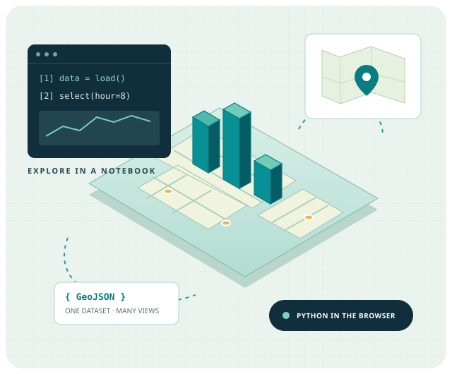

# JupyterLite × PyScript

**Browser Geospatial Lab · James L. Tobias, MS, GISP**

Explore Python in your browser, from your first JupyterLite notebook to PyScript maps and 3D scenes. A companion **Jupyter Book 2** connects the lessons, and one small synthetic NYC dataset travels through every activity.



No learner account, access token, local Python installation or Python backend is required. First loads need internet access for browser runtimes, graphics libraries and map tiles. **Public links below become available after the GitHub Pages workflow is deployed.**

| Start here | Launch | What you will do |
| --- | --- | --- |
| Learning hub | [Open the hub](https://jltobias.github.io/JupyterLite-PyScript/) | Choose a lesson or lab |
| Companion book | [Read the book](https://jltobias.github.io/JupyterLite-PyScript/book/) | Follow the learning path and understand the runtimes |
| JupyterLite | [First notebook](https://jltobias.github.io/JupyterLite-PyScript/lite/lab/index.html?path=01-welcome.ipynb) | Run Python cells and inspect the shared sample |
| Data exploration | [Explore the data](https://jltobias.github.io/JupyterLite-PyScript/lite/lab/index.html?path=02-explore-data.ipynb) | Filter, count and export observations |
| Leaflet 2D map | [Open the map](https://jltobias.github.io/JupyterLite-PyScript/apps/leaflet/) | Show selected points over OpenStreetMap |
| deck.gl 3D map | [Open the columns](https://jltobias.github.io/JupyterLite-PyScript/apps/deck/) | Compare simulated magnitudes in geographic space |
| Three.js 3D scene | [Open the scene](https://jltobias.github.io/JupyterLite-PyScript/apps/scene/) | Compare a local teaching scene with a geographic map |
| App authoring | [Read working source](https://jltobias.github.io/JupyterLite-PyScript/lite/lab/index.html?path=03-author-an-app.ipynb) | Trace the Python-to-JavaScript interaction |
| GIS interoperability | [Try the file handoff](https://jltobias.github.io/JupyterLite-PyScript/integrations/) | Import an exported selection into GeoLibre, RustGIS or JupyterGIS |

JupyterLite's notebook kernel and each PyScript app have **separate Python runtimes and virtual filesystems**. They reuse source and data; they do not share memory or installed packages. PyScript is not a JupyterLite kernel. Move files explicitly with download and upload/import.

## Run locally

Build tools require **Python 3.11+** and **Node.js 22+ with npm on PATH**. Network access is needed to install dependencies and obtain JupyterLite/MyST assets. Use an isolated Python environment:

```sh
python -m venv .venv
```

Activate it with `.venv\Scripts\Activate.ps1` in PowerShell, or `source .venv/bin/activate` in bash. Then:

```sh
python -m pip install -r requirements.txt
python scripts/build.py
python scripts/check_site.py
python scripts/preview.py
```

Open **http://127.0.0.1:8000/**. The build produces one `_site/` tree containing the landing page, labs, book and JupyterLite. It packages the sample dataset, notebooks and actual app source into JupyterLite. Source lessons can be run without installing extra Python packages.

For the GitHub Pages repository path, build and preview with:

```sh
python scripts/build.py --base-url /JupyterLite-PyScript
python scripts/check_site.py
python scripts/preview.py
```

Open **http://127.0.0.1:8000/JupyterLite-PyScript/**. `preview.py` mounts the build at its recorded prefix. MyST receives the corresponding `/JupyterLite-PyScript/book` base URL; app and landing links are relative.

## Verify the live apps

```sh
python -m pip install -r requirements-dev.txt
python -m playwright install chromium
python -m unittest discover -s scripts -p "test_*.py"
python scripts/browser_smoke.py
```

An existing Chrome/Chromium can be selected with `--browser-executable "path/to/chrome"`. The check starts its own local server and exercises the recorded URL prefix. It loads actual browser Python and all three renderers, selects six points at 08:00, checks filtered and zero-feature downloads, verifies mobile layouts and book/Lab routes, and tests blocked-CDN and unavailable-WebGL messages. Screenshots are written under `tmp/browser/`.

`check_site.py` validates generated launch routes and local links, notebook schemas and packaged sources, deterministic data, and shared Python filtering/export including empty results. These artifact checks complement live browser checks; they do not replace them.

## Publish with GitHub Pages

[The workflow](.github/workflows/pages.yml) installs the pinned build tools, builds the combined tree, runs artifact and browser checks, and uploads one Pages artifact. Pushes to `main` deploy through Actions; pull requests build and check without deploying.

A repository maintainer selects **Settings → Pages → Source: GitHub Actions** once, then commits and pushes the source to `main`. The workflow derives the base path from the repository name. Adjust that path if using a custom domain or a user-site repository.

## Source map

| Location | Purpose |
| --- | --- |
| [site/](site/) | Responsive landing page, original SVG splash and PyScript app routes |
| [site/apps/shared/](site/apps/shared/) | Python callbacks, pinned runtime config and JavaScript renderer adapters |
| [content/selection.py](content/selection.py) | Shared standard-library filtering and GeoJSON serialization |
| [content/](content/) | Three notebooks and the shared teaching dataset |
| [book/](book/) | Jupyter Book 2 / MyST chapters and navigation |
| [scripts/](scripts/) | Assembly, preview, deterministic source generators and verification |
| [.github/workflows/pages.yml](.github/workflows/pages.yml) | Combined build/check/deploy pipeline |

Regenerate source artifacts with `python scripts/generate_data.py` and `python scripts/create_notebooks.py` when their generators change. Avoid editing `_site/`: it is generated.

## Data, inspiration and boundaries

The sample has **24 deterministic synthetic NYC observations**, generated by [scripts/generate_data.py](scripts/generate_data.py). Neighborhood coordinates are approximate; hours, offsets and values are invented. These are **not measured taxi trips, health records or observations of people**. Dataset metadata and every feature carry synthetic labels. GeoJSON uses WGS 84 / EPSG:4326, in longitude/latitude order, and export retains provenance and selection count.

Explore the independently maintained [NYC Taxi Panel/deck.gl example hosted under @ambv](https://pyscript.com/@ambv/nyc-taxi-panel-deckgl-copy/latest?files=README.md). For related inspectable source, see [HoloViz Panel's NYC deck.gl gallery](https://panel.holoviz.org/gallery/nyc_deckgl.html), by HoloViz/Panel and contributors. Their work is external inspiration; our synthetic sample is separate. Full credits, source listings and license links appear in [Citations, source materials and attributions](#citations-source-materials-and-attributions).

The integration lesson exchanges GeoJSON through [GeoLibre Web](https://web.geolibre.app/), [RustGIS Web](https://web.rustgis.app/) and [JupyterGIS Lite](https://jupytergis.readthedocs.io/en/latest/lite/lab/index.html). RustGIS Python targets native CPython; JupyterGIS Lite has preview limitations, including no real-time collaboration, QGIS project conversion, server raster tiling or functioning STAC search. See [GeoLibre URL handoff docs](https://geolibre.app/user-guide/embedding/), [RustGIS import formats](https://rustgis.app/user-guide/data/) and [JupyterGIS documentation](https://jupytergis.readthedocs.io/en/latest/).

The apps pin [PyScript 2026.7.3](https://docs.pyscript.net/2026.7.3/user-guide/configuration/) with Pyodide 0.29.0, Leaflet 1.9.4, deck.gl 9.1.14 and Three.js 0.180.0. The separately built JupyterLite kernel manages its own Pyodide runtime. Build packages are pinned in [requirements.txt](requirements.txt); the book uses [MyST static export](https://mystmd.org/guide/deployment). Maps use © [OpenStreetMap contributors](https://www.openstreetmap.org/copyright). The splash illustration is original SVG artwork.

Browser storage can be cleared; download important work. The 3D labs need WebGL 2. If graphics assets or runtimes are blocked, visible messages explain the failure and navigation remains usable.

## Citations, source materials and attributions

Source and license records checked **October 31, 2026**. The entries below distinguish the external examples and GIS applications from the software used to build and run these labs. The GeoLibre, RustGIS and JupyterGIS software DOIs identify their projects; they do not pin the versions of the independently hosted web applications. For a published analysis, record the version actually used and its release-specific DOI where available.

### Geospatial applications and recommended citations

1. **GeoLibre.** Wu, Q. (2026). *GeoLibre: A lightweight, cloud-native GIS platform for visualizing, exploring, and analyzing geospatial data* [Software]. Zenodo. [doi:10.5281/zenodo.20785400](https://doi.org/10.5281/zenodo.20785400). Credit: **Qiusheng Wu and GeoLibre contributors**. See the [recommended citation](https://geolibre.app/citation/), [CITATION.cff](https://github.com/opengeos/GeoLibre/blob/main/CITATION.cff), [source repository](https://github.com/opengeos/GeoLibre), [documentation](https://geolibre.app/) and [MIT license](https://github.com/opengeos/GeoLibre/blob/main/LICENSE). The interoperability lesson uses the documented [GeoJSON URL handoff](https://geolibre.app/user-guide/embedding/) and [data import](https://geolibre.app/user-guide/adding-data/).

2. **RustGIS.** Wu, Q., Rincón Albarracín, J. G., Filho, E., Hofbauer, D., Fitzgerald, M., & Strebel, D. (2026). *RustGIS: A fast, free and open-source GIS in pure Rust for mapping, analyzing and sharing geospatial data* [Software]. Zenodo. [doi:10.5281/zenodo.23633281](https://doi.org/10.5281/zenodo.23633281). This author list follows the project's maintained [CITATION.cff](https://github.com/opengeos/RustGIS/blob/main/CITATION.cff). See the [citation guide](https://rustgis.app/citation/), [source repository](https://github.com/opengeos/RustGIS), [data import documentation](https://rustgis.app/user-guide/data/) and [Apache-2.0 license](https://github.com/opengeos/RustGIS/blob/main/LICENSE).

3. **JupyterGIS software.** The GeoJupyter Community and JupyterGIS contributors. (2026). *JupyterGIS* [Software]. Zenodo. [doi:10.5281/zenodo.22045276](https://doi.org/10.5281/zenodo.22045276). The complete contributor and release metadata are in [CITATION.cff](https://github.com/geojupyter/jupytergis/blob/main/CITATION.cff). See the [source repository](https://github.com/geojupyter/jupytergis), [documentation](https://jupytergis.readthedocs.io/en/latest/) and [BSD-3-Clause license](https://github.com/geojupyter/jupytergis/blob/main/LICENSE). The import instructions also reference the [introductory tutorial](https://jupytergis.readthedocs.io/en/latest/user_guide/tutorials/01-intro/index.html) and the project's [GeoJSON layer UI test](https://github.com/geojupyter/jupytergis/blob/main/ui-tests/tests/geojson-layers.spec.ts).

4. **JupyterGIS paper.** Renou, M., Verma, A., Fisher, M., Mooney, G., Meschede, M., Brichet, N., Brochart, D., Verma, N., Fouilloux, A., Corlay, S., & Pérez, F. (2026). JupyterGIS: A Collaborative GIS Environment for JupyterLab. *Journal of Open Source Software, 11*(124), 10383. [doi:10.21105/joss.10383](https://doi.org/10.21105/joss.10383). The [publisher's article and citation record](https://joss.theoj.org/papers/10.21105/joss.10383) provide the paper, complete author credits and its CC BY 4.0 license; the software's license is BSD-3-Clause.

### NYC Taxi examples and data provenance

| Material and credit | Source and use in this repository | Licensing / provenance |
| --- | --- | --- |
| **PyScript.com account `@ambv`**, *NYC Taxi Panel/deck.gl copy* | [Exact hosted example](https://pyscript.com/@ambv/nyc-taxi-panel-deckgl-copy/latest?files=README.md); linked as inspiration for hour-based geospatial interaction | Credit identifies the hosting account, not independently established original authorship. The hosted copy's license was not independently verified; no license grant is inferred from its public URL. |
| **HoloViz/Panel team and contributors**, *NYC DeckGL* | [Gallery explanation](https://panel.holoviz.org/gallery/nyc_deckgl.html) and [source notebook](https://github.com/holoviz/panel/blob/main/examples/gallery/nyc_deckgl.ipynb); reference for filtering, geographic aggregation and trip arcs | Panel's [BSD-3-Clause license](https://github.com/holoviz/panel/blob/main/LICENSE.txt) credits the HoloViz team, © 2018. This license does not establish the license of a separately hosted copy or its data. |
| **HoloViz-hosted `nyc_taxi_small` sample** | [Parquet file loaded by the Panel gallery](https://datasets.holoviz.org/nyc_taxi_small/v1/nyc_taxi_small.parq); identifies the external example's data dependency | The file is not bundled or loaded by these local teaching labs. A software license is not assigned to the data here; consult the sample's own provenance and terms before reusing it. |
| **New York City Taxi and Limousine Commission (TLC)**, *TLC Trip Record Data* | [Official trip records, data dictionaries and metadata](https://www.nyc.gov/site/tlc/about/tlc-trip-record-data.page); a real-data reference for future extensions | Consult the dataset metadata and [NYC.gov terms of use](https://www.nyc.gov/main/terms-of-use). TLC identifies contributing technology providers on its data page. These records are not inputs to the synthetic sample. |

The 24 observations in [content/data/nyc-observations.geojson](content/data/nyc-observations.geojson) are generated entirely by [scripts/generate_data.py](scripts/generate_data.py). Their hours, values and coordinate offsets are invented; approximate neighborhood coordinates provide geographic context. They are **not an extract, anonymization or sample of TLC/HoloViz trip records**. Attribution for this teaching dataset is **James L. Tobias's JupyterLite × PyScript Browser Geospatial Lab**, with provenance retained in the exported GeoJSON metadata and `simulated` fields.

### Browser Python, mapping and publishing software

The local adapters use the official APIs and examples linked below. Versions identify the direct components used here; bundled dependencies retain their own upstream credits and licenses.

| Component and credit | Role / implementation references | Upstream license |
| --- | --- | --- |
| **PyScript developers**, originated at Anaconda; PyScript 2026.7.3 | Browser app framework. [Project/source](https://github.com/pyscript/pyscript), [configuration](https://docs.pyscript.net/2026.7.3/user-guide/configuration/), [DOM/JavaScript](https://docs.pyscript.net/2026.7.3/user-guide/dom/), [events](https://docs.pyscript.net/2026.7.3/user-guide/events/), [examples gallery](https://pyscript.com/@examples) | [Apache-2.0](https://github.com/pyscript/pyscript/blob/main/LICENSE) |
| **Pyodide developers and contributors**; app interpreter 0.29.0 | Python/WebAssembly runtime. [Source](https://github.com/pyodide/pyodide), [package loading and compatibility](https://pyodide.org/en/0.29.0/usage/loading-packages.html) | [MPL-2.0](https://github.com/pyodide/pyodide/blob/0.29.0/LICENSE); bundled CPython and packages have additional licenses |
| **JupyterLite contributors**; core 0.8.7 and Pyodide kernel 0.8.6 | Browser notebook environment. [Core source](https://github.com/jupyterlite/jupyterlite), [kernel source](https://github.com/jupyterlite/pyodide-kernel), [deployment documentation](https://jupyterlite.readthedocs.io/en/stable/quickstart/deploy.html) | BSD-3-Clause: [core](https://github.com/jupyterlite/jupyterlite/blob/main/LICENSE), [kernel](https://github.com/jupyterlite/pyodide-kernel/blob/main/LICENSE) |
| **Project Jupyter / JupyterLab contributors** | Lab interface and notebook file operations. [Source](https://github.com/jupyterlab/jupyterlab), [file upload/download guide](https://jupyterlab.readthedocs.io/en/stable/user/files.html) | [BSD-3-Clause](https://github.com/jupyterlab/jupyterlab/blob/main/LICENSE) |
| **Jupyter Book contributors**; Jupyter Book 2.1.7 | Companion book. [Source](https://github.com/jupyter-book/jupyter-book), [documentation](https://jupyterbook.org/stable/), [recommended scholarly citation](https://jupyterbook.org/stable/cite/) | [BSD-3-Clause](https://github.com/jupyter-book/jupyter-book/blob/main/LICENSE) |
| **Project Jupyter / MyST contributors and Executable Books** | MyST document engine and book theme. [Engine source](https://github.com/jupyter-book/mystmd), [theme source](https://github.com/jupyter-book/myst-theme), [static export and base URLs](https://mystmd.org/guide/deployment) | MIT: [engine](https://github.com/jupyter-book/mystmd/blob/main/LICENSE), [theme](https://github.com/jupyter-book/myst-theme/blob/main/LICENSE) |
| **Volodymyr Agafonkin, CloudMade and Leaflet contributors**; Leaflet 1.9.4 | 2D map. [Source](https://github.com/Leaflet/Leaflet), [quick-start examples](https://leafletjs.com/examples/quick-start/) | [BSD-2-Clause](https://github.com/Leaflet/Leaflet/blob/v1.9.4/LICENSE); © 2010–2023 Volodymyr Agafonkin and © 2010–2011 CloudMade |
| **vis.gl contributors**; deck.gl 9.1.14 | Geographic columns and tiled basemap. [Source](https://github.com/visgl/deck.gl), [standalone API](https://deck.gl/docs/get-started/using-standalone), [TileLayer / BitmapLayer example](https://deck.gl/docs/api-reference/geo-layers/tile-layer) | [MIT](https://github.com/visgl/deck.gl/blob/v9.1.14/LICENSE); copyright vis.gl contributors |
| **three.js authors and contributors**; Three.js 0.180.0, including OrbitControls | 3D scene, camera controls and rendering. [Source](https://github.com/mrdoob/three.js), [manual](https://threejs.org/manual/#en/fundamentals), [OrbitControls source](https://github.com/mrdoob/three.js/blob/r180/examples/jsm/controls/OrbitControls.js) | [MIT](https://github.com/mrdoob/three.js/blob/r180/LICENSE); © 2010–2025 three.js authors |
| **Python Software Foundation and Python contributors** | CPython and the Python standard library. [Python](https://www.python.org/), [documentation](https://docs.python.org/3.13/) | [Python license agreements and included notices](https://docs.python.org/3.13/license.html) |
| **Node.js contributors** | Local/CI book build runtime. [Source](https://github.com/nodejs/node), [project](https://nodejs.org/) | [MIT and bundled third-party notices](https://github.com/nodejs/node/blob/main/LICENSE) |
| **Microsoft and Playwright contributors**; Playwright 1.56.0 | Browser verification, screenshots and download checks. [Source](https://github.com/microsoft/playwright), [documentation](https://playwright.dev/python/) | [Apache-2.0](https://github.com/microsoft/playwright/blob/v1.56.0/LICENSE) |
| **IPython and Jupyter development teams**; nbformat 5.10.4 | Notebook format validation. [Source](https://github.com/jupyter/nbformat), [documentation](https://nbformat.readthedocs.io/en/stable/) | [BSD-3-Clause](https://github.com/jupyter/nbformat/blob/main/LICENSE) |

**Jupyter Book / MyST scholarly reference:** Project Jupyter et al. (2025). *Jupyter Book 2 and the MyST Document Stack: A modular, extensible, web-native stack for authoring and publishing computational narratives*. Proceedings of the 24th Python in Science Conference, 173–193. [doi:10.25080/hwcj9957](https://doi.org/10.25080/hwcj9957). See the [official citation page](https://jupyterbook.org/stable/cite/) for the complete author list and citation metadata.

### Basemap, format and service attributions

- **OpenStreetMap:** **© [OpenStreetMap contributors](https://www.openstreetmap.org/copyright)**. The Leaflet and deck.gl basemaps use OpenStreetMap tiles. OpenStreetMap data are available under the **Open Database License (ODbL)**; follow the [copyright/license and attribution guidance](https://www.openstreetmap.org/copyright) and [tile usage policy](https://operations.osmfoundation.org/policies/tiles/). Keep the visible map attribution when reusing these views or publishing images containing the basemap.
- **GeoJSON:** Butler, H., Daly, M., Doyle, A., Gillies, S., Hagen, S., & Schaub, T. (2016). *The GeoJSON Format* (RFC 7946). Internet Engineering Task Force. [doi:10.17487/RFC7946](https://doi.org/10.17487/RFC7946). [Authoritative specification](https://www.rfc-editor.org/rfc/rfc7946). This defines the feature collections, longitude/latitude coordinate order and foreign-member metadata used for exchange.
- **GitHub and the GitHub Actions contributors:** repository hosting, CI and Pages publishing. [GitHub Pages custom-workflow documentation](https://docs.github.com/en/pages/getting-started-with-github-pages/using-custom-workflows-with-github-pages) and the [workflow's action/source listings](.github/workflows/pages.yml).
- **jsDelivr:** delivery of the versioned browser runtime/graphics assets referenced in [pyscript.json](site/apps/shared/pyscript.json) and [lab.js](site/apps/shared/lab.js). [Service website](https://www.jsdelivr.com/). The delivered software remains credited to its respective authors above.

### Project background and retaining credits

**Background presentation:** Tobias, J. L. (2026, October 13). *JupyterLite: Geospatial Data Science and Global Health* [Presentation supplied by the repository author]. The presentation informed the browser-first learning path and selection of related tools; it is not redistributed here. The repository's splash illustration is original SVG artwork created for this learning hub.

The license links above apply to the named upstream components. When copying, adapting or redistributing their code or built assets, retain the copyright, license, disclaimer and any applicable `NOTICE` files supplied upstream; record modifications where the applicable license requires it. Preserve data-provider attribution separately from software credits. These README citations complement those notices rather than replacing them, and do not grant a license to separately hosted examples or datasets.
